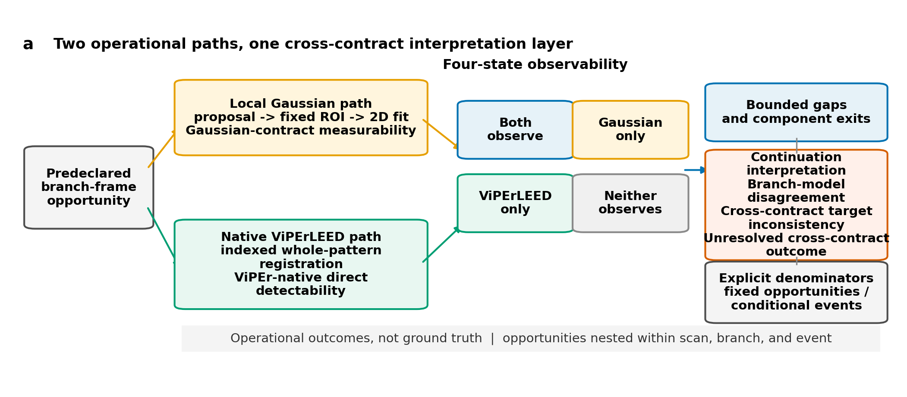
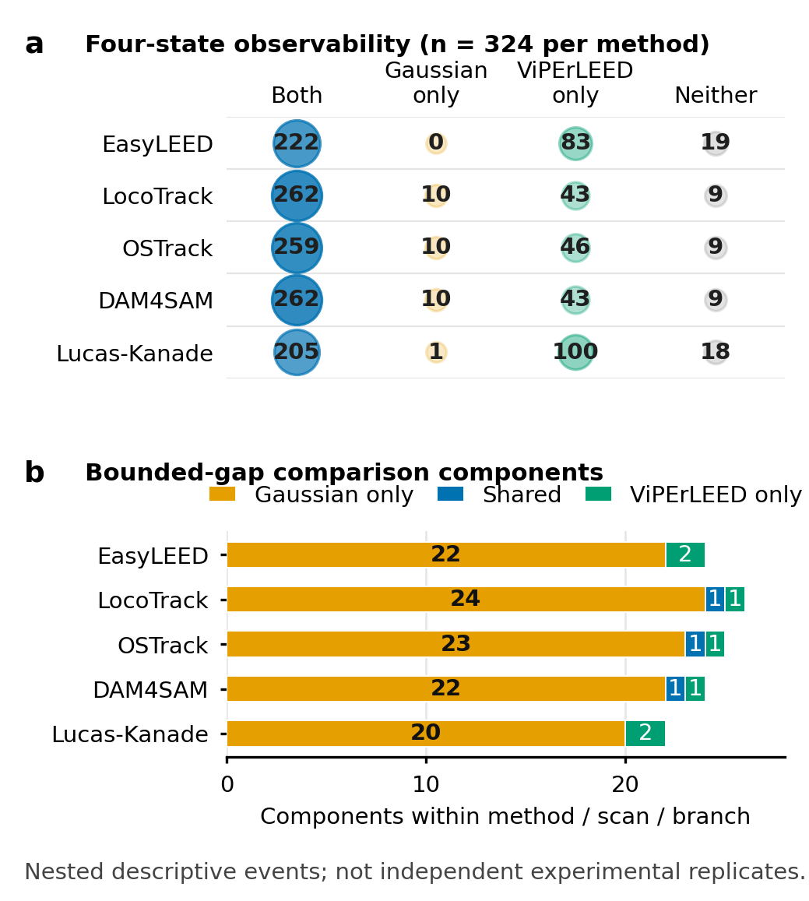
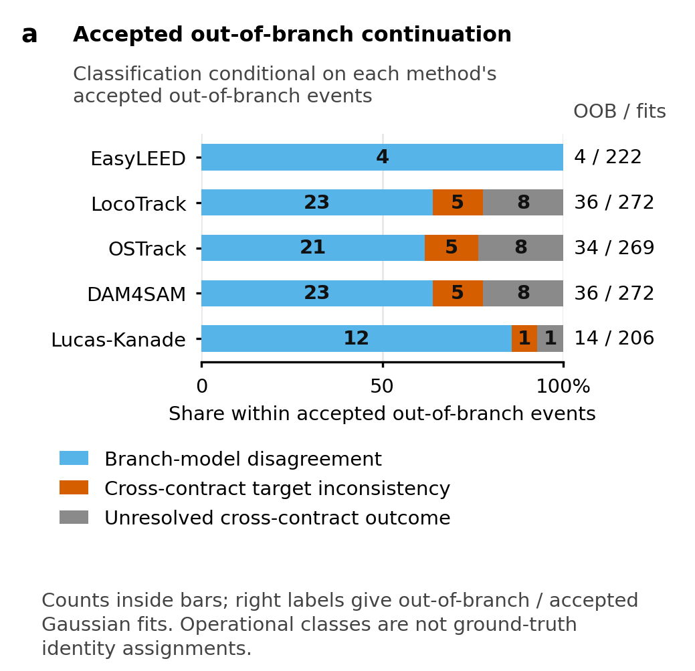

# Continuity is not consistency: Cross-contract observability in LEED spot measurement chains

## Abstract

Continuous tracker output is useful for quantitative low-energy electron
diffraction only when the associated measurement remains observable and
physically consistent. We asked whether those properties were stable across a
local TrackLEED Gaussian measurement contract and an external native
whole-pattern ViPErLEED contract. Two principal energy scans supplied 324
predeclared branch-frame opportunities per method. All opportunities were
retained. Every method produced more ViPErLEED-only than Gaussian-only states
(43-100 versus 0-10), while the contracts yielded 114 Gaussian-contract gaps
and two ViPEr-native visibility gaps. Among 124 accepted Gaussian
out-of-branch continuations, native evidence classified 83 as branch-model
disagreement, 16 as Cross-contract target inconsistency, and 25 as Unresolved
cross-contract outcomes. Fixed branch-consistent coverage used 221 reference
opportunities per method, whereas conditional out-of-branch fractions used
206-272 accepted Gaussian fits. Neither contract was treated as visibility,
position, or spot-identity ground truth. These results show that continuity
alone is insufficient:
measurement-chain robustness requires a cross-contract, denominator-aware
assessment of observability and failure semantics.

## 1. Introduction

### 1.1 Measurement continuity is not a physical conclusion

Low-energy electron diffraction (LEED) derives surface-structure information
from energy-dependent diffraction patterns. Quantitative analysis commonly
uses the intensity of indexed beams as a function of incident energy, but spot
position, shape, and pair geometry are also informative image-derived
quantities [@pendry1974leed; @mayer2012easyleed; @schmid2025viperleed]. Each
quantity depends on an association between a target diffraction spot and the
pixels from which the measurement is obtained. When a pattern moves, contracts,
or changes intensity, a continuous coordinate sequence can preserve that
association, lose it, or continue through frames in which the intended spot is
not directly measurable.

This distinction separates tracking continuity from measurement validity. A
tracker can return coordinates in every frame even if the local image no
longer supports an accepted measurement. Conversely, a native
whole-pattern method can directly detect an indexed beam when a local
proposal-to-Gaussian pathway rejects its fit. A smooth trajectory is therefore
not itself evidence that the intended spot remained observable, and a missing
local result is not itself evidence that the diffraction feature physically
disappeared. Both statements depend on the measurement contract that converts
an image and a tracking output into an operational state.

The problem is especially important in an energy scan. Reciprocal-space
geometry predicts an approximately radial contraction of a LEED pattern as
electron energy increases, while intensity variations can make individual
beams weak or temporarily undetectable. A local measurement chain may use a
proposal to place a small region of interest and then refine a spot center. A
whole-pattern chain can instead identify the indexed lattice, register the
pattern, and estimate the native beam position from information distributed
across the screen. Both pathways are scientifically meaningful, but they do
not have interchangeable endpoints. Their agreement or disagreement must be
reported without elevating either endpoint to an unobserved ground truth.

### 1.2 Two established LEED pathways create a cross-contract question

EasyLEED and ViPErLEED demonstrate that automated LEED spot association,
energy-aware motion models, and quantitative image extraction have established
precedents. EasyLEED combines an energy-informed Kalman prediction with local
image measurement for individually initialized spots [@mayer2012easyleed].
ViPErLEED-ImageJ registers an indexed diffraction pattern using reciprocal
lattice geometry, energy scaling, aperture measurements, and local pattern
corrections to support native beam tracking and I(V) extraction
[@schmid2025viperleed]. The present work does not claim to invent LEED spot
tracking, radial scaling, aperture measurement, or gap bridging.

Their different architectures motivate the present comparison. Within the
local TrackLEED Gaussian contract, EasyLEED is one of five proposal sources.
Its saved state indicates where the common local region should be measured;
the reported endpoint is the finite Gaussian-refined spot position that passes
the same frozen acceptance gates used for the other four proposal methods. In
contrast, ViPErLEED is retained as an external indexed whole-pattern
measurement contract. Its native significance and raw beam-position
deviations are evaluated directly and are not passed through the TrackLEED
Gaussian estimator. ViPErLEED is therefore neither a sixth equivalent tracker
in the local comparison nor a ground-truth label for it.

General-purpose methods can still probe the proposal side of the local chain.
The tested set comprises point correspondence, bounding-box tracking,
mask-based propagation, classical optical flow, and EasyLEED's
physics-informed state estimate [@cho2024locotrack; @ye2022ostrack;
@videnovic2025dam4sam; @lucas1981iterative]. Their native outputs differ, but each is
reduced to the same limited role: placing a local measurement region. This
design avoids ranking heterogeneous native coordinate conventions as if they
were commensurate position measurements. It instead asks whether complete
measurement chains preserve the availability and physical consistency needed
for quantitative use.

Most tracking evaluations condition error on successful output. Such a
surviving set can hide the cases that matter most to measurement robustness.
Coverage can fall while conditional residuals appear stable; a local fit can
remain accepted while its position departs from a predeclared physical branch;
and a method can return after a bounded gap without establishing that the same
spot identity was recovered. These outcomes require different denominators.
Fixed opportunities are needed for coverage, event-specific components for
gap exits, accepted fits for conditional continuation fractions, and direct
native observations for cross-contract positional interpretation. Pooling
frames, branches, methods, or contracts as independent experimental replicates
would erase that structure.

### 1.3 Objective and bounded contribution

We ask whether LEED spot measurability, bounded gap recovery, and physical
consistency remain stable across the local Gaussian and native ViPErLEED
measurement contracts. The analysis retains every predeclared branch-frame
opportunity, assigns four joint observability states, compares bounded gap
events within their method, scan, and branch nesting, and uses direct native
evidence to interpret accepted local continuations outside a frozen radial
branch model. A limited predeclared threshold and positional-tolerance grid
tests whether the conclusions depend on one nominal setting.

The contribution is a cross-contract, denominator-aware assessment of failure
semantics in LEED spot-tracking measurement chains. It is not a universal
tracker ranking and not a claim of absolute tracking accuracy. The principal
result is that observability and gap attribution depend strongly on the
measurement contract, while a continuous accepted local output can represent
branch-model disagreement, Cross-contract target inconsistency, or an
Unresolved cross-contract outcome. This framing turns continuity from a
presumed success criterion into one input to an explicitly qualified physical
interpretation.

## 2. Methods

### 2.1 Acquisition-closed study design and opportunity set

The study used existing-acquisition-only evidence from two principal energy
scans. No new LEED acquisition, detector calibration, sample preparation, or
instrument measurement was introduced for this analysis. The first scan
contained 35 retained source frames and the second contained 46. Four
predeclared radial branches were mapped in each frame, giving
`4 x (35 + 46) = 324` branch-frame opportunities. The opportunity key joined
scan, source frame, energy, and mapped branch. Duplicate terminal energies
remained separate source frames rather than being collapsed.

Five local proposal methods were evaluated at every opportunity: EasyLEED,
LocoTrack, OSTrack, DAM4SAM, and Lucas-Kanade optical flow. This produced 1,620
method-opportunity rows. The native ViPErLEED state belonged to the mapped
indexed branch at the same scan, source frame, and energy and was reused across
the five method strata; it was not counted as five independent native
observations. Opportunities were nested within scan and branch, and bounded
gap events added a further nesting level. All counts are consequently
descriptive within these strata. Frames, branches, methods, and the two
contracts applied to the same acquisition are not experimental replicates.

The existing scientific panel supplied the frozen local candidate and
evaluation records. The native principal-scan package supplied the immutable
ViPErLEED exports and their lossless four-branch reduction. Both packages were
joined one-to-one under a contract committed before the cross-contract counts
were computed. Missing, rejected, subthreshold, inferred, and edge observations
remained in the matrix. No opportunity was removed because one pathway lacked
an accepted result.

TODO[EXPERIMENT] Supply and approve the complete experimental description.

This placeholder is limited to author-approved sample, instrument,
preparation, and acquisition reporting. It does not authorize changes to the
frozen opportunity set, measurement contracts, analysis thresholds, or result
denominators.

### 2.2 Local Gaussian measurement contract

Each local method first produced a tracking proposal in its native
representation. LocoTrack supplied a propagated point, OSTrack a tracked box,
DAM4SAM a propagated mask, Lucas-Kanade an optical-flow displacement, and
EasyLEED an energy-informed state estimate. Frozen adapters converted those
outputs into a location for a common local measurement region. The adapters
did not redefine a method's native output as the reported physical position.

The selected raw-image region entered the same two-dimensional Gaussian spot
estimator for all five methods. A record satisfied **Gaussian-contract
measurability** (`G=1`) only when the estimator returned a finite
Gaussian-refined spot position and every frozen local acceptance gate passed.
The state is an operational endpoint of the complete proposal, region, fit,
and acceptance pathway. It is not physical visibility, native tracker success,
or absolute position accuracy. A rejected fit was retained as `G=0`; deliberate
tracker abstention was not inferred from rejection alone.

Physical branch consistency was evaluated separately from measurability. The
local physics baseline defined reference-visible opportunities and an allowed
radial branch. An accepted Gaussian position could therefore be measurable yet
classified as out of branch. This separation prevents coverage and physical
consistency from being combined into one generic score. It also preserves the
possibility that a simplified radial model and an independently observed native
target disagree for reasons that do not imply loss of spot identity.

### 2.3 Native whole-pattern ViPErLEED measurement contract

The external contract used ViPErLEED-ImageJ 1.03 through its native indexed
whole-pattern pathway. A restricted pilot froze the pattern, screen geometry,
beam mapping, mask, and tracking settings before the principal native outcomes
were available. The final pilot screen fit was transferred unchanged to each
principal scan. The pilot served as calibration evidence and was not treated
as an independent confirmation dataset.

The full native exports retained 18 indexed beams across all frames. Four
preregistered branches were reduced without loss for the cross-contract join.
A mapped beam satisfied **ViPEr-native direct detectability** (`V=1`) only when
its native significance met the nominal threshold of 2.5 and both raw
position deviations were finite. A smoothed, extrapolated, or final native
coordinate alone did not qualify. All 19 non-direct branch observations were
retained among the 324 opportunities, even where a final native position was
available.

Native raw deviations were transformed through the declared coordinate
alignment to obtain the mapped direct target used for cross-contract distance.
The native output was not cropped into a local region and was not refitted by
the TrackLEED Gaussian estimator. This preserves the scientific contrast:
local evidence depends on a proposal-specific region and accepted local image
fit, whereas native evidence depends on indexed pattern registration and a
direct beam observation. Neither endpoint supplies absolute position or
spot-identity ground truth.

### 2.4 Four-state observability and denominator rules

For every method-opportunity row, the binary contract states defined four
mutually exclusive outcomes: both contracts observe (`G=1, V=1`), Gaussian
only (`G=1, V=0`), ViPErLEED only (`G=0, V=1`), and neither contract observes
(`G=0, V=0`). Each method retained the fixed denominator of 324. Counts were
reported separately by method because the five local proposal pathways are
strata applied to the same acquisitions, not independent repetitions that can
be pooled into a denominator of 1,620.

Three additional denominators answer different questions. First,
branch-consistent measurement coverage uses the fixed set of 221
physics-baseline-visible opportunities for each method. Its numerator is the
number with an accepted Gaussian measurement on the predeclared radial branch.
Second, the all-frame conditional out-of-branch fraction uses all accepted
Gaussian fits for the method, which ranges from 206 to 272, as its denominator;
its numerator is the accepted out-of-branch count. Third, continuation
classification is conditional on the 124 accepted out-of-branch events across
method strata, not on all 324 opportunities and not on the fixed set of 221.

Percentages are reported only after these numerators and denominators are
named. Fixed coverage and conditional continuation fractions are not summed,
averaged, or treated as components of a composite method score. A method can
have high fixed branch-consistent coverage while also contributing more
accepted out-of-branch events because it returns more accepted fits overall.
The two quantities describe different properties of the measurement chain.

**Figure 1.** Two predeclared operational paths evaluate each branch-frame opportunity: local proposal-to-Gaussian refinement and native indexed whole-pattern detection. Their four-state outcome layer supports contract-specific gap and continuation interpretation with explicit denominators; neither path is position, visibility, or spot-identity ground truth.

### 2.5 Bounded gaps and comparison components

A **Gaussian-contract gap** was a maximal contiguous run of `G=0` for one
method, scan, and branch, bounded immediately before and after by `G=1` for the
same stratum. A **ViPEr-native visibility gap** was the corresponding maximal
bounded run of `V=0` for one indexed beam within one scan, with direct native
detections on both sides. Runs reaching an edge without both boundaries were
retained as non-direct observations but were not relabeled as bounded gaps.
Neither gap definition establishes physical disappearance or an
estimator-independent I(V) visibility gap.

Gap intervals from the two contracts were compared separately within each
method, scan, and branch. Overlapping closed intervals were joined into a
comparison component. A component was Gaussian-only, ViPErLEED-only, or shared
according to the contracts represented. Exact boundary agreement required one
gap from each contract with identical first and last gap frames. At the first
frame after each component, the analysis recorded whether each contract
observed. This quantity is described as joint observation at component exit,
not proven recovery of physical spot identity.

### 2.6 Interpreting accepted out-of-branch continuations

An accepted local fit outside the predeclared radial branch was retained as an
accepted out-of-branch event. If the mapped indexed beam had a direct native
observation, the aligned Gaussian-to-native distance determined one of two
interpretations at the nominal positional tolerance of 1.0 px. A distance at
or below tolerance was **branch-model disagreement**: the local measurement
departed from the simplified branch model but remained consistent with the
direct native target. A distance above tolerance was **Cross-contract target
inconsistency**. Such inconsistency is compatible with possible false
persistence, but it does not prove a ground-truth identity switch, a local
tracking error, or a native failure.

An event without the required direct native observation was retained as an
**Unresolved cross-contract outcome**. A final or smoothed native position did
not resolve it. Unresolved cross-contract outcomes were neither assigned to
branch-model
disagreement nor Cross-contract target inconsistency, and were not removed
from the conditional denominator. These rules separate lack of direct evidence
from evidence of positional disagreement.

### 2.7 Predeclared sensitivity and reporting

The nominal analysis used native significance 2.5 and positional tolerance
1.0 px. A limited Cartesian sensitivity grid used significance thresholds
2.0, 2.5, and 3.0 and tolerances 0.5, 1.0, and 2.0 px. All nine variants were
reported for all five method strata, producing 45 method-variant rows. No
variant was selected, and the grid was not used to optimize a method ranking.

All analyses were descriptive. The nested opportunities and comparison
components do not support treating row counts as independent sample size for
hypothesis tests. We therefore report exact counts, explicit fixed or
conditional denominators, and bounded sensitivity ranges rather than pooled
confidence intervals or significance tests. Machine-readable per-opportunity
records, configurations, and hashes remain repository artifacts rather than
reader-facing main-text displays.

## 3. Results

### 3.1 Observability differed across measurement contracts

The native contract directly detected 305 of 324 mapped branch opportunities
and retained 19 non-direct states. The local measurable count varied with the
proposal method: 222 for EasyLEED, 272 for LocoTrack, 269 for OSTrack, 272 for
DAM4SAM, and 206 for Lucas-Kanade. Combining these states showed a consistent
directional asymmetry. Every method contained more ViPErLEED-only than
Gaussian-only opportunities.

For EasyLEED, the both/Gaussian-only/ViPErLEED-only/neither counts were
222/0/83/19. The corresponding counts were 262/10/43/9 for LocoTrack,
259/10/46/9 for OSTrack, 262/10/43/9 for DAM4SAM, and 205/1/100/18 for
Lucas-Kanade. Each four-number set sums to the fixed denominator of 324. The
five method rows were not pooled because the shared native state and common
acquisitions would make a pooled 1,620-row percentage appear more independent
than the design permits.

**Figure 2.** Cross-contract observability and bounded-gap comparison. Each measurability row retains 324 fixed opportunities per method. Gap bars count overlap-connected components formed within method, scan, and branch; these nested descriptive events are not independent experimental replicates.

### 3.2 Bounded gap attribution was strongly contract specific

The local chains produced 114 Gaussian-contract gaps: 22 for EasyLEED, 25 for
LocoTrack, 24 for OSTrack, 23 for DAM4SAM, and 20 for Lucas-Kanade. The native
contract produced two ViPEr-native visibility gaps. Other native non-direct
states occurred at unbounded edges or runs and remained explicit without being
promoted to bounded events.

Comparison within method, scan, and branch yielded 121 overlap-connected
components. Of these, 111 were Gaussian-only, seven were ViPErLEED-only, and
three were shared. All three shared components contained one gap from each
contract with exactly matching boundaries. The component counts are larger
than the 114 local gap count because the two native intervals are compared
separately within each method stratum, and overlap connectivity can partition
or combine the represented intervals according to their boundaries. They are
descriptive event components, not 121 independent experiments.

Both contracts observed at the first frame after 118 of 121 comparison
components. The method-stratified values were 23/24 for EasyLEED, 26/26 for
LocoTrack, 24/25 for OSTrack, 24/24 for DAM4SAM, and 21/22 for Lucas-Kanade.
The three non-joint exits remained in the denominator. This high frequency of
joint observation at component exit does not make the gap definitions
equivalent: most components contained a gap from only one contract.

### 3.3 Continuous accepted output separated into three interpretations

Across method strata, 124 accepted Gaussian fits were outside the
predeclared radial branch. Direct native evidence classified 83 as
branch-model disagreement. In these events, the Gaussian measurement differed
from the simplified radial model but remained within 1.0 px of the mapped
direct native target. Sixteen events met the definition of Cross-contract
target inconsistency because the aligned direct targets differed by more than
1.0 px. The remaining 25 were Unresolved cross-contract outcomes because no
direct native observation was available.

The method-specific conditional denominators were 4, 36, 34, 36, and 14 for
EasyLEED, LocoTrack, OSTrack, DAM4SAM, and Lucas-Kanade, respectively. EasyLEED
contributed 4/0/0 branch-model disagreement/Cross-contract target
inconsistency/Unresolved cross-contract outcome events;
LocoTrack 23/5/8; OSTrack 21/5/8; DAM4SAM 23/5/8; and Lucas-Kanade 12/1/1.
These values sum within method to its accepted out-of-branch denominator and
across methods to 83/16/25.

This split changes the meaning of continuity. The 83 branch-model disagreements
show that leaving the predeclared radial branch does not necessarily imply
disagreement with the independently mapped native target. The 16
Cross-contract target inconsistencies provide evidence of contract-level
positional disagreement and are compatible with possible false persistence,
but neither contract can establish which target represents ground-truth
identity. The 25 Unresolved cross-contract outcomes support neither
interpretation. Retaining
them prevents missing direct evidence from being silently converted into
agreement or failure.

**Figure 3.** Interpretation of accepted Gaussian out-of-branch continuations. Each method-specific bar is conditional on its accepted out-of-branch events (4, 36, 34, 36, and 14), not on all 324 opportunities or the fixed 221 reference-visible set. Cross-contract target inconsistency is not proof of a ground-truth identity switch, and events without direct native evidence remain Unresolved cross-contract outcomes.

### 3.4 Fixed coverage and conditional continuation answer different questions

Branch-consistent measurement coverage used 221 fixed
physics-baseline-visible opportunities per method. The numerators were 214 for
EasyLEED, 217 for LocoTrack, 216 for OSTrack, 216 for DAM4SAM, and 188 for
Lucas-Kanade. These correspond to 96.8%, 98.2%, 97.7%, 97.7%, and 85.1% after
the common denominator has been stated. The result describes how often each
local chain produced an accepted position on the predeclared branch within the
fixed reference set.

The all-frame conditional out-of-branch fraction used a different denominator:
all accepted Gaussian fits for the method. The counts were 4/222 (1.8%) for
EasyLEED, 36/272 (13.2%) for LocoTrack, 34/269 (12.6%) for OSTrack, 36/272
(13.2%) for DAM4SAM, and 14/206 (6.8%) for Lucas-Kanade. These conditional
fractions cannot replace fixed coverage. In particular, a method can have a
larger conditional numerator because it retained more accepted fits, while
another method can have a smaller numerator partly because fewer fits survived
the local contract. The measurements do not support collapsing the two
outcomes into a universal score.

### 3.5 Limited sensitivity preserved observability but bounded interpretation

All nine predeclared combinations of native significance and positional
tolerance reproduced the nominal four-state observability counts. Changing
the native threshold over 2.0-3.0 did not change those method totals within
the tested data. The central conclusion that observability differed between
the two contracts therefore did not depend on selecting one favorable variant.

Positional tolerance did affect how direct out-of-branch events were
interpreted. EasyLEED remained fixed at four branch-model disagreements and
zero Cross-contract target inconsistencies. Across variants, the branch-model
disagreement and Cross-contract target inconsistency counts ranged from 17-26
and 2-11 for LocoTrack, 15-24 and 2-11 for OSTrack, 17-26 and 2-11 for DAM4SAM,
and 7-13 and 0-6 for Lucas-Kanade. The Unresolved cross-contract outcome count remained fixed
within each method because tolerance cannot create a direct native
observation where none exists.

Thus, the sensitivity grid supports the contract-dependence of observability
and the need for three continuation categories. It also bounds the stronger
interpretation: the allocation between branch-model disagreement and
Cross-contract target inconsistency depends on the declared tolerance. The
grid is not a complete capture-basin analysis, parameter optimization, or
basis for choosing a preferred method.

## 4. Discussion

### 4.1 Observability belongs to a measurement chain

The dominant result is not that one contract found more spots in an intrinsic
sense. It is that the operational availability of a LEED spot measurement
changed with the pathway used to construct it. The local contract required a
method-specific proposal, a valid region, a finite two-dimensional Gaussian
fit, and all local acceptance gates. The native contract required an indexed
whole-pattern registration, sufficient native significance, and finite raw
beam-position deviations. Because those endpoints test different evidence,
their four-state disagreement is scientifically expected rather than an error
to be averaged away.

The large number of ViPErLEED-only states illustrates this point. Whole-pattern
registration can retain direct indexed evidence when a local region or fit
does not satisfy its acceptance contract. That does not establish physical
visibility outside the native definition, and it does not show that the local
tracker failed in isolation: proposal placement, image content, fitting, and
acceptance all contribute to `G=0`. Conversely, Gaussian-only states show that
the local image model can produce an accepted position when the native direct
criterion is not met. They do not validate the local target against an
external identity reference.

The gap comparison reinforces the same boundary at an event scale. The local
contract produced many more bounded gaps, yet both contracts usually observed
at the comparison-component exit. A simple statement that the spot
"disappeared and recovered" would conflate operational rejection, direct
native detectability, and physical beam intensity. The terms Gaussian-contract
gap and ViPEr-native visibility gap preserve which evidence was absent and how
the run was bounded. Joint observation at exit records a useful measurement
fact without claiming recovery of ground-truth physical identity.

### 4.2 Native evidence changes the interpretation of continuity

The continuation analysis shows why a returned coordinate cannot be treated as
success by default. All 124 events had an accepted Gaussian-refined position,
so a local availability-only analysis would retain them as measurements.
However, their physical interpretation differed. Most were consistent with a
direct native target despite leaving the simplified radial branch. These 83
events identify a branch-model limitation rather than direct cross-contract
target disagreement. Treating every out-of-branch position as tracking failure
would therefore overstate what the radial model can decide.

The 16 Cross-contract target inconsistencies are a narrower warning. They
identify an accepted local continuation that differs beyond the frozen
tolerance from a direct observation of the mapped native beam. The pattern is
compatible with possible false persistence because continuity can be
maintained on a target inconsistent with the indexed native position. Yet the
native contract is not spot-identity ground truth, so the evidence cannot prove
an identity switch or assign a unique causal failure to the tracker, adapter,
local fit, native registration, or coordinate alignment. The appropriate
claim is disagreement between complete measurement contracts.

The 25 Unresolved cross-contract outcomes are equally informative for claim
discipline. Without a direct native observation, the analysis cannot decide
whether the accepted local position agrees with the indexed target. Using a
smoothed native coordinate would replace a frozen direct-evidence rule with an
inference selected after the event. Dropping the records would make the
conditional result appear more complete than the evidence permits. Keeping an
explicit Unresolved cross-contract outcome class makes the denominator and
epistemic limit visible.

### 4.3 EasyLEED and ViPErLEED have related but non-equivalent roles

Both EasyLEED and ViPErLEED are prior LEED-domain systems that incorporate
energy-dependent pattern behavior. Their appearance in this study does not
make them interchangeable. EasyLEED participates in the five-method local
comparison because its state estimate is used as a proposal for the common
TrackLEED Gaussian measurement. Its outcome therefore includes the shared
local fit and acceptance contract. ViPErLEED remains outside that common
estimator and supplies the indexed whole-pattern native endpoint.

This relationship is central to the novelty boundary. The work does not
introduce LEED-specific tracking, Kalman prediction, aperture-based extraction,
whole-pattern registration, or I(V) processing. It also does not claim that
preserving native ViPErLEED outputs makes them an absolute reference. The new
contribution is the explicit cross-contract join: every predefined opportunity
is retained, operational states are compared without forcing a common
endpoint, and failure semantics are limited by the evidence each contract can
provide.

The five local methods likewise should not be read as a comprehensive tracker
benchmark. They span useful proposal representations, but the reported counts
belong to the tested scans, adapters, frozen acceptance gates, and existing
outputs. Method-specific differences help expose denominator effects and local
capture behavior. They do not support a universal best-method claim, and the
analysis deliberately computes no composite ranking.

### 4.4 Denominator discipline prevents incompatible claims

Separating denominators is more than a reporting preference. Fixed
branch-consistent coverage asks whether the local chain returned an accepted
measurement on the physical branch for each reference-visible opportunity.
The all-frame conditional fraction asks how frequently accepted local fits
were out of branch. Gap components ask whether bounded absence under one
contract overlaps bounded absence under the other. Continuation classification
asks what direct native evidence says about a selected set of accepted
out-of-branch fits. These are distinct estimands.

Combining them would create several biases. Conditioning every analysis on
accepted fits would remove local non-measurability from view. Using 324 as the
denominator for the out-of-branch interpretation would mix accepted and
unaccepted local states. Using 221 for all-frame continuation would exclude
events outside the reference-visible baseline. Pooling five method rows would
repeat the same native opportunity and inflate apparent sample size. Treating
121 nested components as independent experiments would ignore their shared
scans and branches. The frozen reporting rules prevent each substitution.

### 4.5 Limitations and scope

The study has no instrument-traceable absolute position reference and no
framewise spot-identity ground truth. Cross-contract agreement can support
consistency between operational pathways, and branch geometry can support
physical self-consistency, but neither establishes absolute accuracy. A direct
native beam observation is independent of the local Gaussian endpoint in its
measurement construction, not infallible in physical identity.

The evidence is acquisition closed. It covers two existing principal energy
scans and four preregistered branches under one frozen local contract and one
frozen native contract. The native pilot calibrated settings and therefore
cannot serve as independent confirmation. The five local proposal methods do
not exhaust possible trackers, and the selected region, fit gates, native
threshold, coordinate alignment, and radial baseline bound the results.
Different validated contracts could redistribute operational outcomes.

The sensitivity analysis is deliberately narrow. It establishes that the
observability counts were stable across the predeclared threshold grid and
shows that direct-event interpretation changes with positional tolerance. It
does not optimize parameters, map every capture regime, or validate a method
ranking. In particular, the nominal count of Cross-contract target
inconsistencies should be read together with the sensitivity envelopes and the
non-ground-truth limitation.

Complete experimental reporting and bibliography verification remain explicit
Authorized deferred publication inputs. Their absence prevents the draft from
being `submission-ready`, but
does not license inferred instrument or sample details. The scientific draft
is complete only within the frozen cross-contract question, evidence packages,
and claim boundary. A later integration step must preserve these constraints
when producing journal-formatted editable and rendered documents.

### 4.6 Implications for measurement-chain evaluation

The framework suggests a general order for evaluating quantitative tracking
chains. First define the endpoint produced by each measurement contract.
Second retain a fixed opportunity inventory before examining successful
outputs. Third separate operational availability from physical-consistency
checks. Fourth give each conditional statistic its actual surviving
denominator. Finally, preserve an Unresolved cross-contract outcome category
wherever the comparison contract lacks direct evidence. These steps make it possible to compare
heterogeneous pathways without pretending that their native outputs or errors
are commensurate.

## 5. Conclusions

Across the two principal energy scans, LEED spot observability and gap
attribution were not stable across a local Gaussian measurement contract and
an external native whole-pattern ViPErLEED contract. Of 121 bounded gap
comparison components, 111 contained only Gaussian-contract gaps. These
patterns are operational differences between complete pathways, not evidence
that either path reveals physical visibility or spot identity as ground truth.

Continuity also did not determine consistency. The 124 accepted Gaussian
out-of-branch events separated into 83 branch-model disagreements, 16
Cross-contract target inconsistencies, and 25 Unresolved cross-contract
outcomes. The categories remained denominator bound: fixed branch-consistent
coverage used 221 reference opportunities per method, conditional
out-of-branch fractions used 206-272 accepted fits, and interpretation used
only the accepted out-of-branch events. Limited sensitivity preserved the
observability result while showing that the split between direct-event
interpretations depends on positional tolerance.

The resulting contribution is a cross-contract, denominator-aware assessment
of failure semantics in LEED spot-tracking measurement chains. It preserves
the established roles of EasyLEED and ViPErLEED, avoids a universal tracker
ranking, and keeps cases without direct evidence unresolved. Measurement-chain
robustness in this setting therefore requires explicit assessment of both
continuity and physical consistency under named operational contracts.

## References

The provisional citation keys in this draft resolve to the repository's
existing bibliography and identify established LEED, tracking, and
whole-pattern sources. They are not represented as a submission-complete
reference list.

TODO[SUBMISSION] Complete and verify the bibliography from primary sources before submission.
